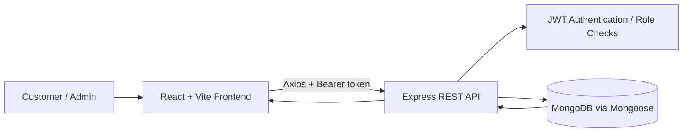

# 🛒 Freshmart — MERN Grocery E-Commerce Platform

Freshmart is a full-stack grocery shopping application built with React, Vite, Node.js, Express, and MongoDB. The app includes a searchable product catalog, shopping cart, checkout flow, customer order history, and protected admin screens.

> **Project status:** Portfolio/learning project. COD/Card/UPI are stored as order payment-method choices; do not treat card or UPI checkout as a real payment gateway unless a provider integration is added and verified.

## Features

### Shopping experience
- Responsive homepage with promotional banners and featured categories.
- Product catalog with name/category/description search, category filtering, and sorting.
- Product details and stock information.
- Cart with quantity controls and persistent client-side state.
- Checkout form with address, email, phone, pincode, and payment-method validation.
- Order history, order status display, and reorder flow.

### Accounts and administration
- Registration and login with bcrypt password hashing and JWT authentication.
- Role-aware admin pages.
- Admin order listing.
- Product create, update, and delete endpoints guarded by JWT authentication and an admin-role check.

### Stack
| Layer | Technology |
| --- | --- |
| Frontend | React, Vite, React Router, Axios, CSS |
| Backend | Node.js, Express |
| Database | MongoDB, Mongoose |
| Authentication | JSON Web Tokens, bcryptjs |
| Tooling | npm, ESLint |

## Architecture



## Repository layout

```text
E-Commerce-Website/
├── frontend/             # React + Vite application
├── backend/
│   ├── middleware/       # Authentication and admin authorization
│   ├── models/           # Mongoose models
│   ├── routes/           # API routes
│   ├── .env.example      # Safe local environment template
│   └── server.js         # Express app and API endpoints
├── .gitignore
├── package.json
└── README.md
```

## Prerequisites

- Node.js (use a currently supported LTS release)
- npm
- MongoDB locally or a MongoDB connection string

## Local setup

### 1. Clone and install

```bash
git clone https://github.com/Neemasree/E-Commerce-Website.git
cd E-Commerce-Website
npm install
cd backend
npm install
cd ../frontend
npm install
```

### 2. Configure backend environment

Create `backend/.env` based on `backend/.env.example`:

```dotenv
MONGO_URI=mongodb://127.0.0.1:27017/grocery_db
JWT_SECRET=replace_with_a_random_secret_at_least_32_characters_long
PORT=5000
```

Use a unique, randomly generated secret for your own machine and a different secret in production. Never commit `.env` or real credentials. If a real secret was ever committed, rotate it even after removing the file from the current branch.

### 3. Start the backend

```bash
cd backend
npm run dev
```

The API defaults to `http://localhost:5000`. When deploying the frontend, set `VITE_API_BASE_URL` to the backend API origin ending in `/api` (for example, `https://your-backend.example/api`).

### 4. Start the frontend

In a second terminal:

```bash
cd frontend
npm run dev
```

Vite normally serves the frontend at `http://localhost:5173`.

## API overview

| Method | Endpoint | Purpose | Access |
| --- | --- | --- | --- |
| POST | `/api/auth/register` | Register a customer | Public |
| POST | `/api/auth/login` | Log in | Public |
| GET | `/api/products` | List/search/filter/sort products | Public |
| GET | `/api/products/:id` | Fetch product details | Public |
| POST | `/api/products` | Create a product | Admin token |
| PUT | `/api/products/:id` | Update a product | Admin token |
| DELETE | `/api/products/:id` | Delete a product | Admin token |
| POST | `/api/orders` | Place an order | Authenticated customer |
| GET | `/api/orders` | View own orders | Authenticated customer |
| GET | `/api/admin/orders` | View all orders | Admin token |

All protected requests should send `Authorization: Bearer <token>`.

## Scripts

Run scripts from the relevant folder. Backend and frontend dependencies are managed separately.

**Backend**
- `npm start` — start the server.
- `npm run dev` — start with nodemon.
- `npm run seed` — run the product seed script.

**Frontend**
- `npm run dev` — start Vite.
- `npm run build` — create a production build.
- `npm run lint` — run ESLint.
- `npm run preview` — preview the production build.

The backend `npm test` command runs the built-in Node.js test runner. Current tests cover admin-role middleware; route integration and checkout transaction tests are still needed.

## Security and known limitations

- Configure `JWT_SECRET` with a strong random value of at least 32 characters. The backend refuses to start without it.
- The product mutation endpoints require authentication and an admin role.
- `.env`, environment-specific files, dependencies, logs, and build output are excluded by `.gitignore`.
- Removing a file from the latest commit does not erase it from historical Git commits. Rotate any credentials that may have been exposed in prior history.
- Installed `node_modules` folders have been removed from the current tracked tree. Git history may still contain older copies; rewrite history only if you deliberately choose to clean old commits.
- Order creation calculates prices on the server and wraps stock decrements plus order persistence in a MongoDB transaction. Transactions require a MongoDB deployment that supports them (such as a replica set); verify this against your target environment.
- Real card/UPI processing requires a verified payment-provider integration. Current payment method labels are not proof that payments are processed.
- Deployment URLs, automated test status, screenshots, and license information should be added only after they have been verified.

## License

No license has been verified for this repository yet. Add a license file if you intend to publish reuse permissions.

## Author

**Neema Sree** — [GitHub](https://github.com/Neemasree)
